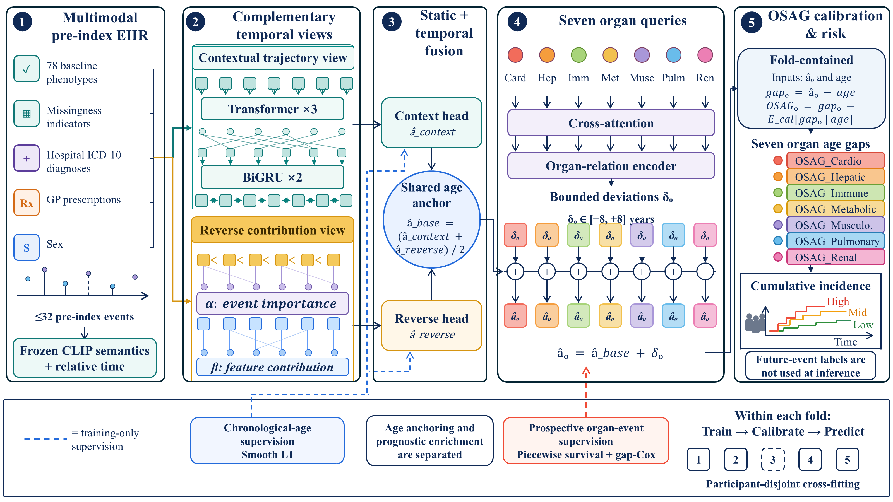

# EHR-AGE



PyTorch implementation of the current EHR-AGE model for deriving seven age-corrected organ-specific prognostic risk markers from longitudinal electronic health records.

The frozen architecture combines 78 baseline phenotypes, missingness indicators, sex, and up to 32 pre-index hospital-diagnosis and GP-prescription events. Frozen CLIP semantic embeddings feed a contextual Transformer and bidirectional-GRU view together with an independent reverse event-contribution view. Their mean forms the shared age anchor, and seven organ queries produce bounded organ-specific deviations.

## Files

- `Dataloader.py`: fold-contained preprocessing and data loading
- `model.py`: EHR-AGE architecture
- `train.py`: joint objectives, training, prediction, and OSAG correction
- `main.py`: command-line entry point

## Environment

Python 3.11, PyTorch 2.5.1, and NumPy are recommended.

## Run

```bash
python main.py --smoke-test --validate-only
python main.py --data data.npz --embeddings clip_embeddings.npz --outer-fold 0 --output-dir outputs/fold0
```

`data.npz` contains the 78 phenotypes, sex, five-fold assignment, padded 32-event tensors, chronological age, strict-reference membership, and organ-specific time-to-event labels. `clip_embeddings.npz` contains `code_embedding` and `text_embedding`. Participant-level UK Biobank and MIMIC-IV data are not redistributed.
